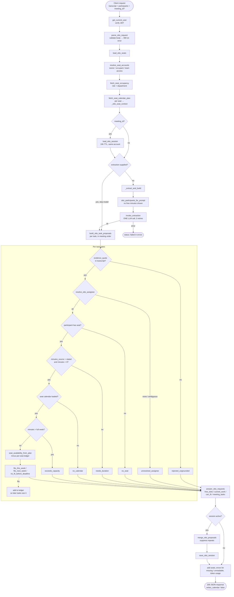
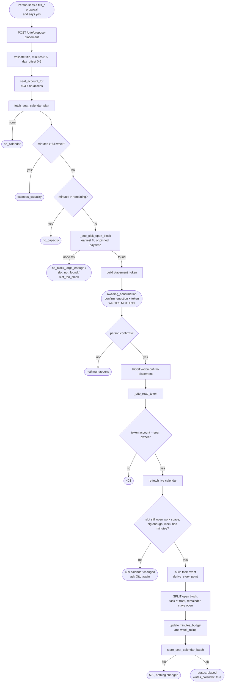

# Otto — code reference

Every function, endpoint, prompt and helper in `otto/`, with a one-line summary, followed by the full flow charts.
Dependency direction: `api → core → capacity → graph → config` (nothing reaches back up).

---

## 1. HTTP endpoints — `api.py`

| Method + path | Function | What it does | Writes? |
|---|---|---|---|
| `POST /otto/meeting-tasks` | `otto_meeting_tasks` | **Main call.** Transcript + participants → validated task proposals + answers to questions asked to Otto. Loads seats, optionally loads/merges/saves the meeting session, extracts (live or supplied) and runs the deterministic gates. | Session only (if `meeting_id`) |
| `POST /otto/propose-placement` | `otto_propose_placement` | Validates `seat_id`, `day_offset` (0–6), calls `propose_otto_placement`. Returns slot + question + token. | No |
| `POST /otto/confirm-placement` | `otto_confirm_placement` | Validates `placement_token`, calls `confirm_otto_placement`. | **Yes** (calendar) |
| `GET /seat-assignments` | `seat_assignments` | Every seat on the caller's account with its occupant (incl. unoccupied) + counts. | No |
| `GET /seat-availability/{seat_id}` | `seat_availability` | Does `task_minutes` (query) fit this seat? Optional `deadline_week`. | No |
| `POST /seat-lookup` | `seat_lookup` | Body `user_id` → that person's `seat_id`, name, role, department. Only endpoint not scoped to the caller (by design, for tooling). 404 if no user / no seat. | No |
| `GET /otto/test-ui` | `otto_test_ui` | Serves `static/otto_test.html` with no-cache headers (same-origin console). | No |
| `GET /health` | `health` | Reports missing settings; pings Neo4j and counts seats. | No |

### api.py internals
| Function | Summary |
|---|---|
| `get_current_user` | FastAPI dependency: decodes the Bearer JWT (HS256). 401 on missing/expired/invalid. |
| `process_token_payload` | Pulls `user_id` from the verified payload; handles `new_access_token` / `new_refresh_token` echo-back. |
| `_read_json` | Reads the body; 400 if empty, not JSON, or not an object. |
| `_extract_and_build` | Builds prompt inputs, calls `invoke_extraction` (the only LLM call), then `build_otto_task_proposals`. Returns `status: failed` + error on model failure. |

---

## 2. Prompts — `prompt.py`

| Name | Role |
|---|---|
| `OTTO_MEETING_TASKS_SYSTEM` | System prompt. Defines what counts as a **task** (concrete action + owner + not retracted + not hypothetical); **owner** (`named` / `inferred_from_role`; non-participants stay owners); **duration** (never invent — `minutes_source: stated|not_stated`); **deadline** (`this_week|next_week|later|null`); **grounding** (`evidence_quote` must be an exact single-line span; `accepted_quote`; `related_current_work` verbatim); **`otto_requests`** (lines addressed to Otto are *classified, never answered*: `free_slots`, `current_work`, `can_fit`, `meeting_tasks`, `unsupported`; `minutes` only if spoken; `refers_to_recent_task`; `target_week`). |
| `OTTO_MEETING_TASKS_HUMAN` | Human template with `{meeting}`, `{participants}`, `{transcript}` and the exact JSON output shape: `tasks[]`, `not_tasks[]`, `otto_requests[]`, `audit[]` (5 self-checks). |

The model is never shown remaining capacity — only role, department, current work and objectives.

---

## 3. LLM layer — `llm.py`

| Function | Summary |
|---|---|
| `build_chain` | `ChatPromptTemplate(system, human) | ChatOpenAI(model, temperature=0)`. |
| `extract_llm_meta` | Pulls content, finish_reason and prompt/completion/reasoning token counts from whichever shape the SDK returns. |
| `invoke_extraction` | The single model call. Up to 3 attempts; strips code fences; parses JSON; requires `tasks`; reports `finish_reason=length` as truncation rather than parsing it. Returns `(extraction, usage, error)`. |
| `summarize_usages` | Totals tokens/calls across passes for `token_usage.summary`. |

---

## 4. Core (deterministic half) — `core.py`

**Constants:** `OTTO_MAX_TRANSCRIPT_CHARS=50000`, `OTTO_MAX_PARTICIPANTS=60`, `OTTO_MAX_SEATS=60`, `_OTTO_WEEKDAYS`.

| Function | Summary |
|---|---|
| `_otto_bad` | Builds a 400 `HTTPException`. |
| `_otto_norm` | Lowercase, non-alphanumerics → spaces. Used for all name/quote comparison. |
| `_otto_quote_found` | Is the normalised quote a substring of the normalised transcript? (the grounding check) |
| `_otto_fmt_min` | 90 → `1h 30m`. |
| `_otto_flatten_transcript` | Accepts text **or** `[{speaker, timestamp, text}]` turns; flattens to `[ts] Speaker: text` lines so the prompt and grounding see one format. |
| `_otto_seat_context` | Turns one stored seat plan into a context dict: role, department, `full_week_minutes`, `plan_week`, `remaining_minutes`, objectives, `current_work` (task titles + minutes), sorted `open_slots`. |
| `otto_session_candidates` | Proposals "this task" may still refer to: live status, not superseded, not placed. |
| `parse_otto_request` | Validates the whole body (400s): transcript, participants (unique names, one seat per person), `meeting.sprint_week`, `meeting_id`, `extraction`. Returns the normalised input. |
| `load_otto_seats` | For each participant seat: resolve owner account (`resolve_seat_accounts`), fetch role/department, fetch calendar plan, build context. Reports `missing` (no calendar) and `unreadable` (no access) instead of raising. |
| `otto_participants_for_prompt` | What the model sees per person: name, host, role, department, current work, objectives — **not** free minutes. |
| `resolve_otto_assignee` | Spoken name → participant: full name, else *unique* first name; `ambiguous` or `none` otherwise. |
| `_otto_week_asked_for` | Which sprint week a question is about: `target_week` first, else parses "week N" / "next week" / "this week" from the text. |
| `build_otto_task_proposals` | **The pipeline.** For each extracted task, in meeting order, runs the gates (see §10) with a per-seat cumulative ledger; then answers `otto_requests`. Returns proposals, answers, `not_tasks`, `model_audit`, `status_counts`, `minutes_proposed_by_seat`, `writes_calendar: false`. |
| `answer_otto_requests` | One answer per classified request: `free_slots`, `current_work`, `can_fit` (incl. "this task" resolution from session + this turn, week-aware), `meeting_tasks`; statuses `answered / needs_clarification / needs_duration / rejected_ungrounded / unresolved_person / no_seat / no_calendar / unsupported`. |

---

## 5. Capacity — `capacity.py`

| Function | Summary |
|---|---|
| `seat_availability_from_plan` | Pure decision on a plan already in hand. Remaining = `week_rollup.task_minutes_remaining` − ledger. Outcomes: `fits_this_week` → `fits_next_week` (next week treated as fully open) → `no_fit_before_deadline` (returns both numbers, never silently moves the deadline). |
| `check_seat_availability` | Reads seat's `capacity_story_points` from Neo4j, resolves owner, rejects `exceeds_capacity`, fetches latest plan, delegates to the function above. `no_calendar` if no seat/capacity/plan. |

---

## 6. Access — `access.py`

| Function | Summary |
|---|---|
| `resolve_seat_accounts` | `seat_id → owner account` if the caller earned access: is the owner, **occupies** the seat, or is on a team the owner owns. Otherwise `None` (reported as unreadable). One Cypher query for all seats. |
| `seat_account_for` | Single-seat version; raises **403** instead of returning empty. |

---

## 7. Placement (the write half) — `placement.py`

**Constants:** `OTTO_PLACEMENT_TOKEN_VERSION=1`, `OTTO_MIN_PLACEMENT_MINUTES=5`, `OTTO_PLACEMENT_SOURCE="otto_meeting"`.

| Function | Summary |
|---|---|
| `_otto_hhmm_to_min` / `_otto_min_to_hhmm` | `"09:30"` ⇄ 570. |
| `_otto_placement_token` | base64url JSON of the resolved slot (seat, week, event index, start, minutes…). Not a security boundary — names one proposal. |
| `_otto_read_token` | Decodes and version-checks a token (400 if unreadable/old). |
| `_otto_open_blocks` | All `open_work_space` events in calendar order, each with its list index. |
| `_otto_pick_open_block` | Earliest-fit block that holds the minutes; an explicit `day_offset`/`start_time` pins the choice. Failure reasons: `no_open_work_space`, `slot_not_found`, `slot_too_small`, `no_block_large_enough`. |
| `propose_otto_placement` | Validates, checks `exceeds_capacity` / `no_capacity`, picks a block, returns `awaiting_confirmation` + `confirm_question` + token + alternatives. **Writes nothing.** |
| `confirm_otto_placement` | Decodes token, checks account, **re-validates against the live calendar** (409 if slot gone/changed/too small/week full), builds the task event, **splits** the open block (task takes the front, remainder stays open; exact fit removes the block), updates `minutes_budget` and `week_rollup`, stores via `store_seat_calendar_batch`. **Writes.** |

---

## 8. Session memory — `session.py`

`OTTO_SESSION_TTL_HOURS = 24`

| Function | Summary |
|---|---|
| `_otto_session_now` | Unix seconds. |
| `_otto_title_key` | Normalised title (first 120 chars) for sameness. |
| `load_otto_session` | Reads `(:OttoSession {meeting_id})`; returns a blank session if absent, older than 24 h (reports `expired_from`), or owned by another account. |
| `save_otto_session` | MERGEs the node, stores proposals/answers/placements as JSON, links to `(:Meeting)` via `HAS_OTTO_SESSION` if one exists. Returns bool. |
| `merge_otto_proposals` | Folds this turn in; a proposal with the same `(assignee, title, minutes)` is **suppressed**. Different minutes ⇒ new proposal. |
| `record_otto_placement` | Marks a session proposal `outcome: placed` and appends the placement. **Not called anywhere in `api.py`** (see §11). |

---

## 9. Data access, helpers, config

### `graph.py` (all Neo4j I/O)
| Function | Summary |
|---|---|
| `fetch_seat_occupancy` | Every `Seat` for an account with its `OCCUPIES` user. |
| `fetch_seat_calendar_plan` | Loads `SeatCalendar` rows for a seat; picks exact `sprint_week`, else legacy un-keyed, else (if no week asked) latest. Returns plan + `plan_source` + `plan_sprint_week`. |
| `store_seat_calendar_batch` | MERGEs `(Seat)-[:HAS_SEAT_CALENDAR]->(SeatCalendar{sprint_week})` and sets the JSON. Keyed by week so weeks don't overwrite each other. |
| `fetch_seat_for_user` | A user's seat (id, name, role, department) — not account-scoped. |

### `helpers.py`
| Name | Summary |
|---|---|
| `_WEEK_CAPACITY` | `part_time` (7 pt, 1070 task-min) / `full_time` (14 pt, 1920 task-min). |
| `_f`, `_i` | Tolerant float/int coercion with default. |
| `_load` | JSON-string-or-dict → dict (unused locally; `session.py` defines its own inner `_load`). |
| `_plan_root` | Unwraps `plan["calendar_events"]` if present. |
| `_week_capacity_for` | Story-point capacity → weekly row (falls back to full-time). |
| `derive_story_point` | Thin wrapper over `story_points.derive_story_point`. |

### `story_points.py`
| Name | Summary |
|---|---|
| `_FIBONACCI_STORY_POINTS`, `_FIBONACCI_SCALE` | Duration bands (SP 0/1/2/3/5) and the 1-2-3-5-8 adjustable scale. |
| `_ceil_div` | Integer ceiling division. |
| `activity_count` | Number of ≤40-min activity atoms for a duration, clamped to the band. |
| `derive_story_point` | Duration → `{story_point, expected_activities, session_span, sessions_needed, exceeds_single_task_band…}`. |

### `config.py`
`logger`, `OPENAI_API_KEY`, `NEO4J_*`, `JWT_SECRET_KEY`, `JWT_ALGORITHM`, `OPENAI_MODEL` (default `gpt-4o`, env `OTTO_MODEL`), `OPENAI_TEMPERATURE=0.0`; `create_driver()` (Aura-safe Neo4j driver); `missing_settings()`.

### Entry points
`__main__.main` (uvicorn runner, `--port`), `__init__.py` (re-exports the library API), `build_otto_package.py` (AST extraction from `rag/`).

---

## 10. Flow chart — `POST /otto/meeting-tasks`



## 11. Flow chart — placing a task on the calendar (two-step)



## 12. Layered architecture

```
 client / test console (otto_test.html)
          │
   api.py ─────────────── JWT auth, 8 endpoints, session orchestration
          │
   core.py ────────────── validate · ground · resolve · gate · answer
      │        │
 capacity.py  placement.py ─── fit decision │ propose → confirm (split block)
      │        │        session.py ───────── short-term memory (OttoSession)
      └──┬─────┘
   access.py ──────────── who may read which seat
      │
   graph.py ───────────── all Neo4j reads/writes
      │
   config.py + helpers.py + story_points.py
          │
   Neo4j (Seat, SeatCalendar, User, OttoSession, Meeting, Team…)   ·   OpenAI (llm.py + prompt.py)
```

---

## 13. Problems found while reading the code

These are observations from reading only; I have not run anything.

1. **`story_points.py` references undefined names** — `_ACTIVITY_CEILING_MINUTES`, `_ACTIVITY_FLOOR_MINUTES`, `_WORKING_SESSION_MINUTES` are never defined, so `derive_story_point` raises `NameError` on every call.
2. **`placement.py:304`** does `from tools.story_point_calendar import derive_story_point`. That module only exists in the main `rag/` app, so in this standalone package `confirm_otto_placement` would fail with `ModuleNotFoundError`. The local `story_points.derive_story_point` is already imported at the top (line 28) and is the right one to use (but see #1).
3. **`record_otto_placement` is never called.** `/otto/confirm-placement` doesn't update the session, so `placed` stays 0 and "this task" can still resolve to something already placed.
4. **`seat_availability_from_plan` never returns `no_calendar`/`needs_duration`** — fine — but `answer_otto_requests` with `fits_future_week` returns a different outcome string from the one the README documents; the UI should handle it.
5. **`OTTO_MAX_SEATS` is defined but unused**, `_load` in `helpers.py` is unused, and `api.py` imports `ThreadPoolExecutor`, `Optional`, `logging` without using them.
6. **`parse_otto_request`** has a stray run of spaces in the `sprint_week` condition (a line-continuation was lost) — harmless but suggests the line was mangled by the extraction script.
